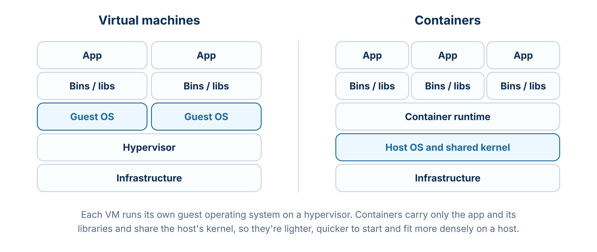
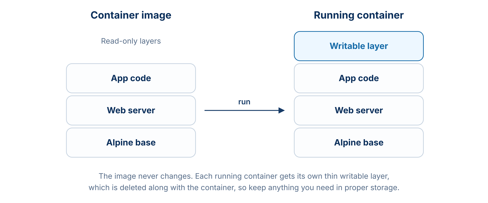
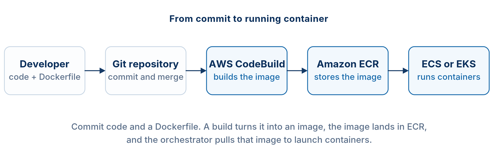
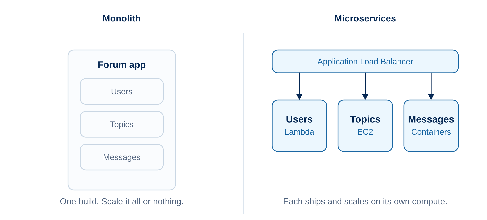
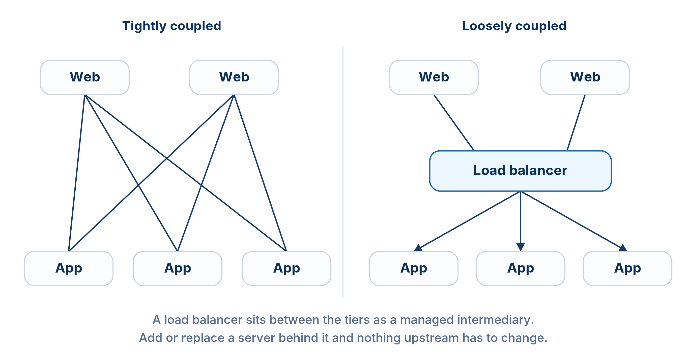

Containers give you a repeatable way to package and run software, but they don't tell you how the application should be structured or which AWS services should run it, so the workload still has to drive those decisions.

# **What a container actually is**

A virtual machine behaves like a separate computer, with its own operating system running on virtualised hardware, whereas a container is normally just an isolated process that shares the host's operating system kernel with other containers. That's why containers are lighter and quicker to start, although on Fargate the sharing stops at the task or pod, because each ECS task or EKS pod there runs in its own isolation boundary and doesn't share a kernel with any other task or pod.

A container image packages the application with the libraries and files it needs, so the exact image you tested can be the one you deploy, and settings or secrets that change between environments are best supplied when it starts rather than built in. It still isn't completely independent of its surroundings, because the processor architecture it was built for, networking, identity, storage and the services it calls can all vary.

# **Images, layers and where they're kept**

An image is built from read-only layers, and a running container adds a thin writable layer on top that's deleted along with the container, so anything written there is lost whenever the container is replaced.

It's worth keeping production images to what the application needs, since smaller images transfer faster and every package you leave out is one less to appear in a vulnerability report.

Once a build has produced an image, you push it to a registry such as Amazon Elastic Container Registry (ECR), which stores Docker and Open Container Initiative (OCI) images and related artefacts. Private repositories are protected with IAM and repository policies, and ECR can scan images for known vulnerabilities, either itself or through Amazon Inspector.

Tags such as `latest` are handy, but they can be moved to a different image, so when you need to know exactly what's running you refer to the image by its content digest. ECS services that use the built-in ECS deployment controller do this for you by default, resolving tags to digests at deployment so every task in that deployment runs the same image, and ECR can make tags immutable so an existing tag can't be overwritten.

# **Containerising an application doesn't mean splitting it up**

Moving to containers doesn't oblige you to break the application into microservices, and a monolith can run perfectly well in a container. Microservices let you deploy and scale parts of an application independently, but you pay for that with network calls between components, failures spread across more moving parts, more interfaces to secure and more to operate. They're worth it when the domain, scaling needs, release model or team structure justify that cost.

What matters more is how the components depend on each other. A load balancer in front of identical copies of a service lets any copy be replaced without anything upstream having to change, which is exactly what you want when containers come and go, and my post on [tightly and loosely coupled architectures](https://thesolutionarchitect.uk/tightly-and-loosely-coupled-architectures-what-actually-depends-on-what) covers the other ways of loosening dependencies.

# **Start with what the workload needs**

It's tempting to jump straight to ECS, EKS or Fargate, but those choices only make sense once you've written down what the workload needs, as I describe in [From requirements to design](https://thesolutionarchitect.uk/from-requirements-to-design). Start with your organisation, because a team already running Kubernetes, with the skills and tooling that come with it, may find EKS a better fit than adopting a second way of orchestrating containers. Then look at the hardware, since GPUs, privileged access, particular instance types or host-level software all narrow your compute options. After that, ask whether demand is steady, variable or unpredictable, what availability and recovery targets you have to meet, which data has to survive a container being replaced, and what you'll need to log, measure and trace. Those answers are the real architecture work, and the service choice follows from them.

# **Choosing between ECS and EKS**

Once containers are running in production, something has to deploy, replace and scale them, and that's the orchestrator's job. Amazon Elastic Container Service (ECS) is AWS's own fully managed container orchestration service, while Amazon Elastic Kubernetes Service (EKS) runs the Kubernetes control plane for you.

ECS suits teams who mainly work with AWS services, have no need for Kubernetes APIs or tooling, and are happy to use ECS's own task definitions in return for fewer concepts to run. EKS earns its place when Kubernetes is already your platform standard, when existing workloads or tools depend on its APIs, when the team already has the skills, or when the Kubernetes ecosystem offers something you specifically need.

Kubernetes gives you a common API, although AWS-specific integrations can still reduce portability. It also leaves more of the running with your team, even with EKS Auto Mode taking on much of the infrastructure. You're responsible for upgrading clusters to newer Kubernetes versions, for instance, and each version gets 14 months of EKS standard support before it moves to extended support, which costs more. So choose EKS because Kubernetes itself adds something, rather than because it's popular.

# **Choosing where the containers run**

Compute is a separate decision, and the options depend on the orchestrator. With ECS, **AWS Fargate** runs tasks without you provisioning or patching EC2 instances, so you set CPU, memory, networking and IAM and AWS supplies the capacity, though you still decide how the application scales. **[Amazon ECS Managed Instances](https://docs.aws.amazon.com/AmazonECS/latest/developerguide/ManagedInstances.html)** suits workloads that need something from the wider EC2 range, such as GPUs or specific instance types, while AWS still handles provisioning, scaling and patching. **EC2 capacity providers** leave running and patching the instances to your team, for when you need control the managed options don't give, such as custom host configuration.

EKS can run pods on EC2 nodes that you manage yourself or through managed node groups, on nodes run by EKS Auto Mode, which also handles much of the networking, load balancing and storage around them, or on Fargate. Fargate on EKS has [limitations](https://docs.aws.amazon.com/eks/latest/userguide/fargate.html) that are easy to miss, as it doesn't support GPUs, privileged containers, DaemonSets, EBS volumes or Fargate Spot.

# **Keep anything that matters outside the container**

A container should be replaceable without losing anything important, which doesn't mean every workload is stateless, only that persistent state lives somewhere with the right durability and lifecycle. Documents and exports suit Amazon S3, relational data suits a managed database such as Amazon RDS, and files that several Linux containers share can live in Amazon EFS, which works with both ECS and EKS, including on Fargate. Ephemeral task, pod or node storage is fine for working data you can afford to lose.

Block storage needs more care, because Amazon EBS behaves differently on each orchestrator. On EKS, EBS volumes can back Kubernetes persistent volumes that outlive individual pods, though only on EC2-based nodes, and because each volume lives in a single Availability Zone, a pod can only reattach to it from that zone. On ECS each task can have one EBS volume, but a volume attached to a service's task is [always deleted when the task stops](https://docs.aws.amazon.com/AmazonECS/latest/developerguide/ebs-volumes.html), so use it for fast working space rather than data that must outlive the task.

# **Logs and metrics need to outlive the container too**

Files inside a container can't be your permanent record, so applications usually write logs to standard output and standard error and let the platform forward them, often to CloudWatch Logs. For ECS, Container Insights with enhanced observability adds task-level and container-level metrics, which makes it far easier to trace a problem to the container causing it. FireLens can also route logs through Fluent Bit or Fluentd to CloudWatch or to other AWS and partner destinations, for Linux tasks on Fargate or EC2. On EKS, the AWS options include CloudWatch Container Insights, Amazon Managed Service for Prometheus and the AWS Distro for OpenTelemetry, and the choice often comes down to what your organisation already runs.

# **Making the choice**

None of these options is right by default, because they differ in the APIs you build against and in how much AWS runs for you compared with what your team runs itself, and the workload questions earlier in this post are what should decide between them. Whichever you choose, treat every container as replaceable and keep anything that matters somewhere that outlasts it.
